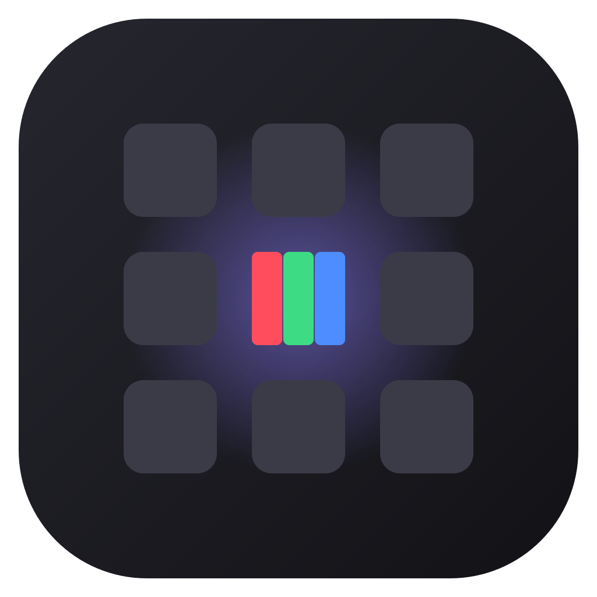

<div align="center">
  

# NitPick

**Find your monitor's best settings. No calibration hardware needed.**

A free, open-source app that walks you through brightness, contrast, gamma, color balance, sharpness and motion with clear test patterns and plain-language advice. Runs on Windows, macOS and Linux, or right in your browser.

[Download](https://github.com/borasavkar/nitpick/releases) · [Try it in your browser](https://borasavkar.github.io/nitpick/) · [Report a bug](https://github.com/borasavkar/nitpick/issues)

</div>

---

## Why NitPick?

Most monitors ship with settings tuned to look flashy in a store: too bright, too blue, over-sharpened, with shadows crushed. Professional calibration needs a colorimeter that costs more than many monitors. NitPick gets you most of the way there with just your eyes and your monitor's menu buttons.

## Features

- **Monitor control.** On monitors that support DDC/CI, change brightness, contrast and red/green/blue balance right from the app, with live sliders in each step and one-click undo. No need to dig through the monitor's buttons.
- **Guided setup.** A short step-by-step wizard covering brightness, black level, white level, gamma, color balance, sharpness, smoothness and motion. Each step asks a simple question and tells you exactly which monitor setting to change.
- **Targets for your use.** Choose what you use the screen for (general, photo, movies, gaming, office) and how your room is lit. NitPick picks sensible brightness, gamma and white point targets.
- **11 test patterns.** Black level, white level, gamma (per channel), gray balance, gradients, sharpness, color bars, uniformity, dead pixels, motion clarity and text clarity.
- **Pixel-exact rendering.** Patterns are drawn at your display's physical resolution, so 1-pixel line patterns stay accurate even with 125% or 150% OS scaling.
- **Saved results.** Keep a record of your monitor settings and the check results for each display, and copy them as text.
- **English and Turkish.** The app picks your language automatically; switch any time from the top bar.
- **Private.** No accounts, no telemetry, no network access. Everything stays on your device.

## Roadmap

| Version | Planned |
| --- | --- |
| 0.1 | Test patterns, guided setup, use-case presets, web version |
| **0.2** | Adjust supported monitors directly from the app over DDC/CI (brightness, contrast, RGB gain) |
| 0.3 | Quick profiles (Day / Movie / Night) from the system tray |
| 1.0 | Multi-monitor workflow, more languages, shareable result cards |

## Install

Download the installer for your system from the [Releases](https://github.com/borasavkar/nitpick/releases) page:

- **Windows:** `setup.exe` installer
- **macOS:** `.dmg` (Apple Silicon and Intel)
- **Linux:** `.AppImage`, `.deb` or `.rpm`

Or use the [web version](https://borasavkar.github.io/nitpick/) with no install.

## Monitor control (DDC/CI)

Most external monitors let software change their settings over DDC/CI. If NitPick says your monitor doesn't respond:

- Turn on **DDC/CI** in the monitor's on-screen menu (some monitors ship with it off).
- Connect the monitor directly; some docks, adapters and KVM switches don't pass DDC/CI through.
- Laptop built-in screens don't use DDC/CI; use your system's brightness keys.
- **Linux:** load the `i2c-dev` module and give your user access, e.g. `sudo modprobe i2c-dev` and `sudo usermod -aG i2c $USER` (then log out and back in).

Monitor control is tested on Windows. Reports from macOS and Linux users are very welcome.

## Build from source

Prerequisites: [Node.js](https://nodejs.org/) 20+, [Rust](https://rustup.rs/) (stable), and the [Tauri prerequisites](https://tauri.app/start/prerequisites/) for your OS.

```bash
npm install
npm run tauri dev      # run the desktop app in development mode
npm run dev            # run only the web version at http://localhost:1420
npm run tauri build    # build installers into src-tauri/target/release/bundle
```

## Project structure

```
src/
  components/   React UI: home, guided setup, pattern viewer, results
  patterns/     Test pattern drawing (pixel-exact canvas)
  lib/          Presets, wizard steps, storage, platform helpers
src-tauri/      Rust / Tauri desktop shell
```

## Contributing

Contributions are welcome: bug reports, new test patterns, better advice texts and translations. See [CONTRIBUTING.md](CONTRIBUTING.md).

## License

[MIT](LICENSE) © 2026 Bora Şavkar
